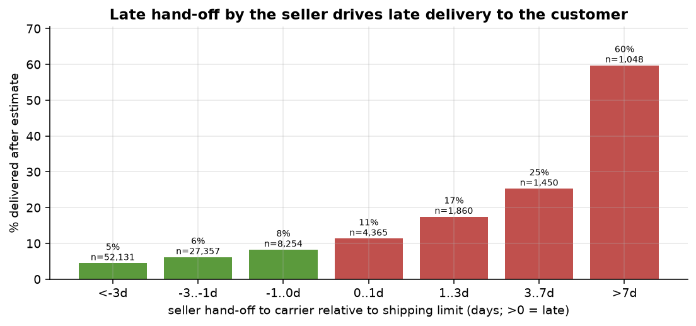
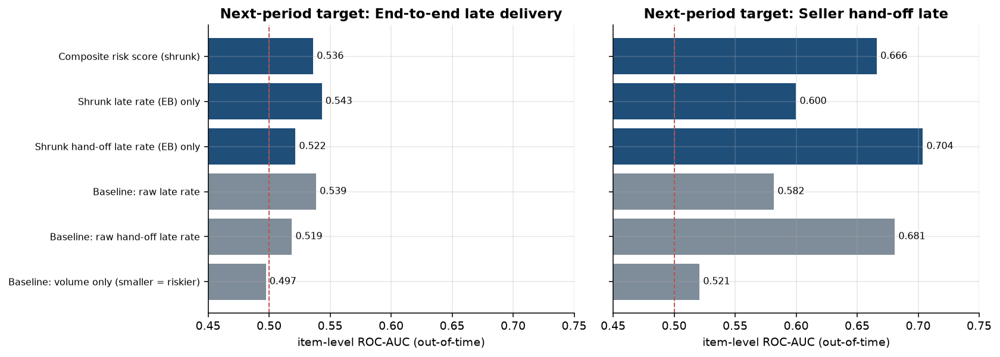
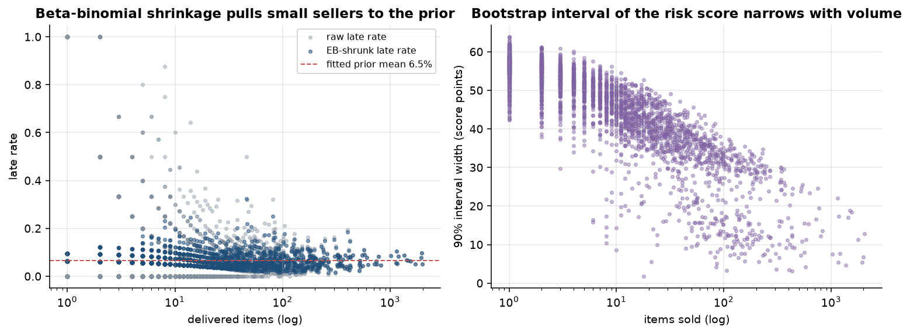
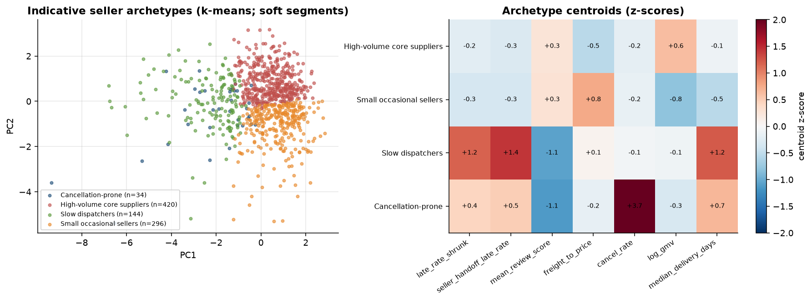
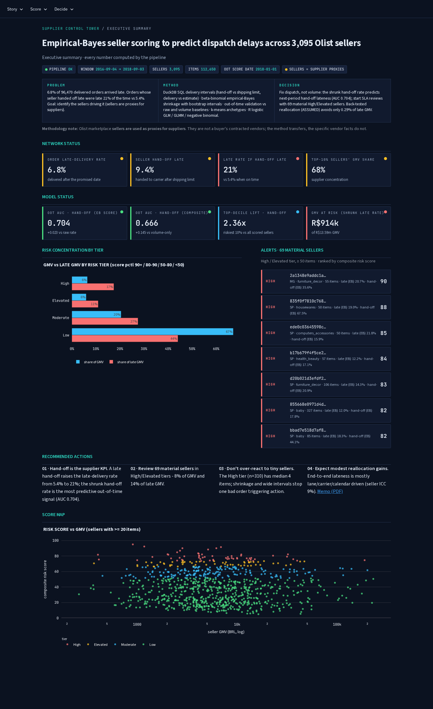
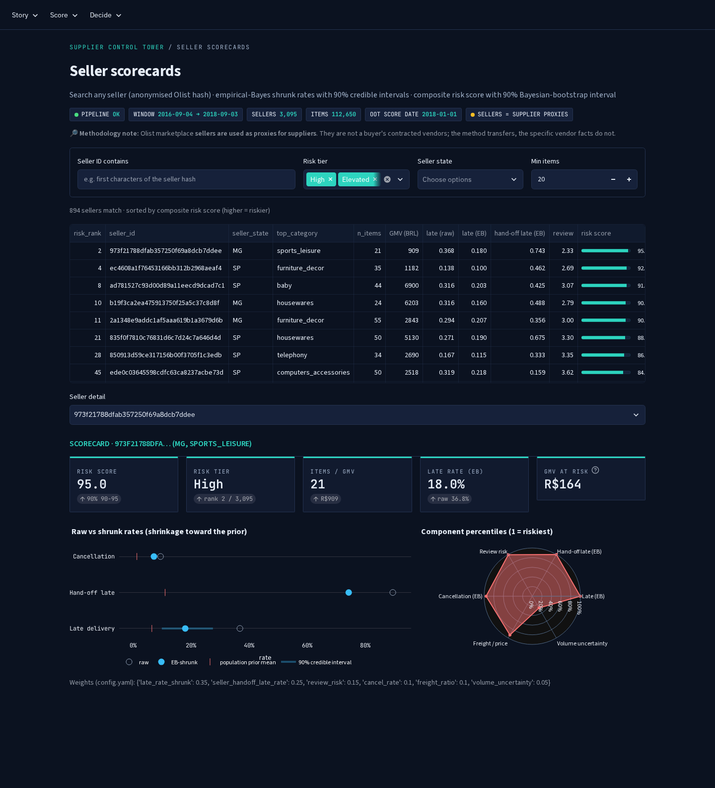
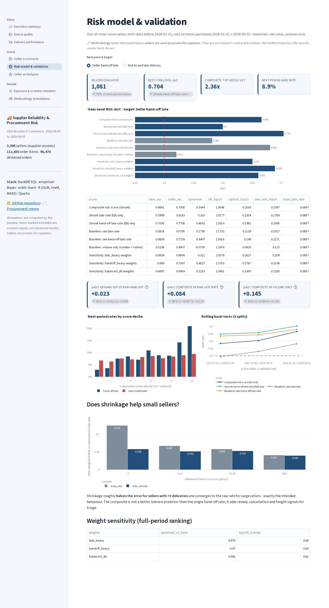
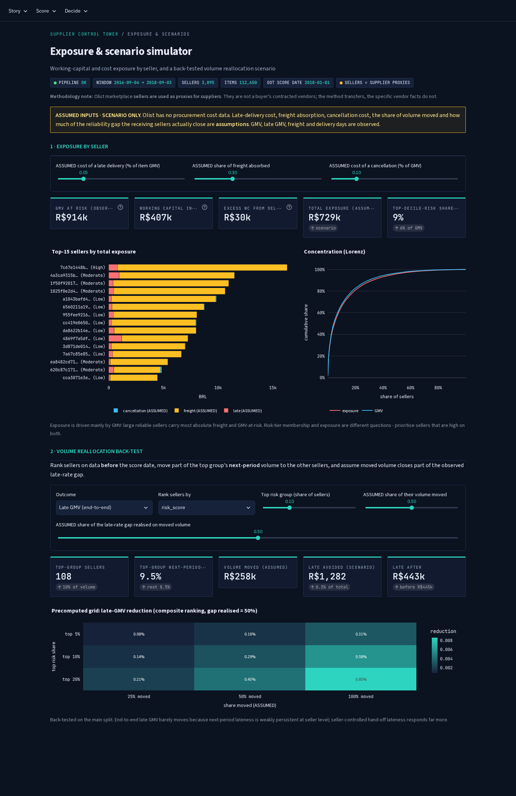
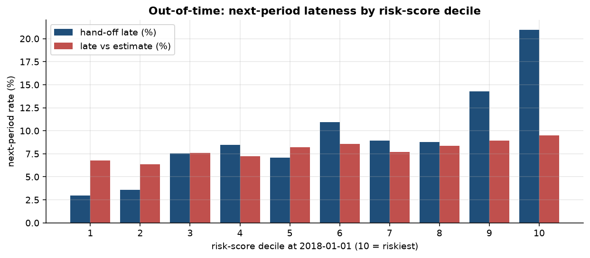
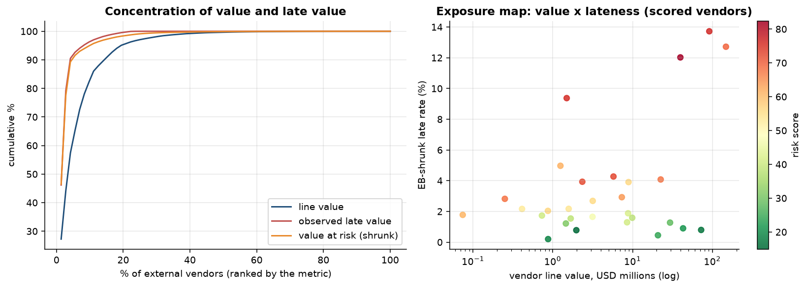

# Supplier Reliability & Procurement Risk Scoring

> **Outcome:** an empirical-Bayes reliability scorecard for 3,095 Olist sellers (used as
> **supplier proxies**) that predicts next-period seller-controlled dispatch lateness out-of-time
> (AUC 0.704 vs 0.681 for the raw rate and 0.521 for
> volume-only; top score decile 21.0% late hand-offs vs
> 2.9% in the bottom decile) - and shows, honestly, that end-to-end customer
> lateness is mostly *not* a stable supplier trait, so volume reallocation alone would barely move it.

[](https://github.com/Abhi237/supplier-risk-scoring/actions/workflows/ci.yml)
· SQL (DuckDB) · Python (empirical Bayes, scikit-learn) · R (GLM, lme4, MASS, Quarto) · Streamlit

| | |
|---|---|
|  |  |
|  |  |

**Deliverables:** [procurement memo (PDF)](docs/procurement_memo.pdf) · [memo (md)](docs/procurement_memo.md) ·
[R delivery report (HTML)](reports/delivery_report.html) · [EDA notebook](notebooks/01_eda.ipynb) ·
[model notebook](notebooks/02_model_walkthrough.ipynb) · [data dictionary](docs/data_dictionary.md) ·
[data model](docs/data_model.md) · [architecture](docs/architecture.md)

> **Methodology note - sellers as supplier proxies.** Olist sellers are independent marketplace merchants who ship
> through Olist's carriers. They stand in for suppliers: they have a dispatch deadline (`shipping_limit_date`), a
> customer promise date, freight cost, cancellations and quality feedback. They are **not** a buyer's contracted
> vendors (no POs, invoices or payment terms), so the *method* transfers to procurement data while vendor-level facts
> do not.

## Interactive app
A multipage Streamlit app (`app/streamlit_app.py`) presents the project for stakeholders. It reads **only** compact
aggregated artifacts committed in `app/data/` (~1 MB: summaries, validation tables, aggregated lane/category tables
and the 3,095 seller scorecards). No customer-level data, no order rows, no ML libraries at deploy time.

| Page | What it shows |
|---|---|
| Executive summary | business question, KPI cards, GMV vs late GMV by risk tier, recommendations |
| Data & quality | integrity counts, pipeline graph, all data-quality checks, cleaning decisions |
| Delivery performance | monthly lateness, hand-off timing vs lateness, lead-time ECDFs, states/categories, GLM odds ratios |
| Seller scorecards | searchable seller lookup: raw vs shrunk rates, credible + bootstrap intervals, component radar |
| Risk model & validation | out-of-time AUC/lift vs baselines for two targets, ΔAUC CIs, deciles, back-tests, shrinkage error |
| Seller archetypes | k-means archetypes in PCA space, centroid heatmap, silhouette/BIC selection |
| Exposure & scenario simulator | **ASSUMED** cost sliders, exposure ranking and concentration, back-tested reallocation |
| Methodology & limitations | definitions, scoring maths, validation design, caveats |

```bash
make app-data        # refresh app/data/ from pipeline outputs
make app             # http://localhost:8501
```
**Deploy on Streamlit Community Cloud:** main file `app/streamlit_app.py`, Python 3.11; dependencies from
`app/requirements.txt` (streamlit, pandas, numpy, pyarrow, plotly). Theme: `.streamlit/config.toml`.

| | |
|---|---|
|  |  |
|  |  |

All eight page screenshots: [`docs/app_screenshots/`](docs/app_screenshots/).

---

## 1. Situation & question
A marketplace operator (standing in for a procurement team) depends on 3,095 independent sellers
to dispatch on time. Late deliveries hurt reviews (2.27/5 when late vs 4.29 on
time) and tie up working capital. The question:

> **Which vendors create the greatest delivery-risk and working-capital exposure?**

Answered with four lenses: **shrunk reliability scores** with uncertainty (who is unreliable, and how sure are we),
**out-of-time validation** (does a score built today predict next period), **seller archetypes** (what kind of
problem), and **exposure + scenario analysis** (how much is at stake, and what would reallocating volume achieve).

## 2. Data
| | |
|---|---|
| Source | [Olist Brazilian E-Commerce](https://www.kaggle.com/datasets/olistbr/brazilian-ecommerce) (CC BY-NC-SA 4.0), fetched from a public GitHub mirror - see [data/README.md](data/README.md) |
| Integrity | orders 99,441 · items 112,650 · sellers 3,095 - all equal to the documented counts; SHA-256 recorded |
| Period | purchases 2016-09-04 to 2018-09-03 |
| Grain | `fct_items`: one row per order x item (112,650); `fct_orders_delivered`: 96,470 delivered orders; `seller_summary`: 3,095 sellers; `seller_month_panel` |
| Size | GMV BRL 13.59m, freight BRL 2.25m (16.6% of price) |
| Concentration | top 10% of sellers = 67.6% of GMV; 1,201 sellers have <5 items |

**Data-quality checks** (`sql/02_data_quality.sql`, counts from `dq_report`): duplicate_order_id = 0, duplicate_item_key = 0, items_orphan_order = 0, items_orphan_seller = 0, orders_without_items = 775, delivered_missing_delivery_ts = 8, missing_approved_ts = 160, missing_carrier_ts = 1,783, carrier_before_purchase = 166, delivered_before_carrier = 23, nonpositive_price = 0, zero_freight = 383, orders_canceled_or_unavailable = 1,234, orders_without_review = 768, products_missing_category = 610.

**Cleaning / definition decisions:** lateness only for delivered orders with a delivery timestamp; late = delivery
*calendar date* after the estimate; hand-off lateness not judged when the carrier timestamp precedes purchase
(166 orders); latest review per order; customer data reduced to state; multi-seller
orders (1.3% of delivered orders) share one delivery timestamp and every seller in them
inherits it.

**Caveats:** sellers are supplier proxies; Olist's estimated date already embeds regional slack; orders purchased near
the data end that were not yet delivered cannot be judged (right-censoring); no cost data exists, so all costs are ASSUMED.

## 3. SQL model (DuckDB, ANSI/Postgres-friendly)
| Script | Output |
|---|---|
| `01_stage.sql` | typed staging; review de-dup (`ROW_NUMBER`) |
| `02_data_quality.sql` | `dq_report` (one row per check) |
| `03_order_intervals.sql` | `fct_items` with approval / hand-off / transit / delivery intervals, late & hand-off flags; `fct_orders_delivered` |
| `04_seller_summary.sql` | `seller_summary` (counts, GMV, late GMV, freight, reviews, medians) |
| `05_seller_month_panel.sql` | seller-month panel with rolling 3-month windows, `LAG`, `RANK`, running totals; `platform_month` |
| `06_oot_features.sql` | point-in-time seller features before `score_end` and next-period outcomes |

Seller-controlled lateness vs the shipping limit:
```sql
DATE_DIFF('second', i.shipping_limit_ts, o.carrier_ts) / 86400.0                    AS handoff_delay_days,
CASE WHEN o.carrier_ts IS NOT NULL AND o.carrier_ts >= o.purchase_ts
     THEN o.carrier_ts > i.shipping_limit_ts END                                   AS is_handoff_late,
CASE WHEN o.order_status = 'delivered' AND o.delivered_ts IS NOT NULL
     THEN CAST(o.delivered_ts AS DATE) > CAST(o.estimated_ts AS DATE) END          AS is_late
```
Rolling seller-month window:
```sql
SUM(n_late) OVER w3::DOUBLE / NULLIF(SUM(n_delivered) OVER w3, 0) AS late_rate_roll3
WINDOW w3 AS (PARTITION BY seller_id ORDER BY purchase_month
              RANGE BETWEEN INTERVAL 2 MONTH PRECEDING AND CURRENT ROW)
```
Point-in-time features (no information from on/after the score date):
```sql
SUM(CASE WHEN f.is_late AND f.delivered_ts < p.score_end THEN 1 ELSE 0 END) AS n_late,
AVG(CASE WHEN f.review_created_ts < p.score_end THEN f.review_score END)    AS mean_review_score
FROM fct_items f CROSS JOIN params p WHERE f.purchase_ts < p.score_end
```

## 4. Python + R
**Python (`src/supplier_risk`, CLI `supplier-risk sql|train`):**
* **Empirical-Bayes beta-binomial shrinkage** (`shrinkage.py`): Beta prior fitted by maximum marginal likelihood -
  late Beta(2.03, 29.05) (mean 6.5%, 31 pseudo-items),
  hand-off Beta(0.51, 4.06) (mean 11.1%), cancellation
  Beta(0.11, 8.01); posterior mean (a+k)/(a+b+n) with 90% credible intervals.
* **Composite risk score** = 100 x Σ w x component percentile, weights documented a priori: late_rate_shrunk 0.35, seller_handoff_late_rate 0.25, review_risk 0.15, cancel_rate 0.1, freight_ratio 0.1, volume_uncertainty 0.05.
* **Uncertainty:** 200-draw Bayesian bootstrap per seller (Dirichlet-weighted outcomes with
  the EB prior as pseudo-data). Median 90% interval width: 51 score points for
  sellers with <20 items vs 24 for >=100 items. (A classical bootstrap gives
  zero width for sellers with 0 late items - wrong direction.)
* **Archetypes:** k-means on 7 standardised features for 894 sellers with >=20 items; k in
  [3, 4, 5, 6, 7] chosen by silhouette (GMM BIC reported alongside).
* **Exposure:** GMV at risk, working capital in transit, excess WC from delays (observed) and ASSUMED cost layers.
* **Out-of-time validation** and **reallocation back-test** (below).

**R (`R/delivery_analysis.R` -> `reports/delivery_report.html`):** logistic GLM for lateness (hand-off, customer &
seller region, lane, freight, GMV, category, month, year), seller random-intercept GLMM (lme4), negative-binomial
lead-time model (MASS), KS / Wilcoxon / Kruskal-Wallis lead-time comparisons with ECDFs, calibration, Hosmer-Lemeshow
and GVIF diagnostics.

## 5. Validation, baselines, metrics, sensitivity
Score sellers using only data observable before **2018-01-01**; evaluate on items purchased
2018-01-01 -> 2018-09-01. 1,081 sellers evaluated, covering
75% of next-period items (new sellers can't be scored). Item-level AUC = each
next-period item inherits its seller's score. Next-period base rates: hand-off late 8.9%,
late delivery 7.8%.

| Score | Hand-off: item AUC | seller AUC | Spearman | top-10% lift | Late delivery: item AUC | top-10% lift |
|---|---|---|---|---|---|---|
| **EB-shrunk hand-off rate** | 0.704 | 0.771 | 0.456 | 2.26x | 0.522 | 1.06x |
| **Composite risk score** | 0.666 | 0.701 | 0.344 | 2.36x | 0.536 | 1.21x |
| EB-shrunk late rate | 0.600 | 0.618 | 0.203 | 2.02x | 0.543 | 1.19x |
| Baseline: raw hand-off rate | 0.681 | 0.728 | 0.441 | 2.56x | 0.519 | 1.25x |
| Baseline: raw late rate | 0.582 | 0.579 | 0.180 | 2.17x | 0.539 | 1.22x |
| Baseline: volume only | 0.521 | 0.491 | -0.071 | 1.30x | 0.497 | 1.01x |

* **Shrinkage vs raw** (hand-off target): ΔAUC +0.023 (seller-cluster
  bootstrap 95% CI +0.012 to +0.039).
  Item-weighted MAE vs next-period late rate for sellers with <5 deliveries: raw 0.124 ->
  shrunk 0.058; for 100+ deliveries 0.041 -> 0.040.
  The raw hand-off rate has a higher top-10% lift (2.56x vs 2.26x)
  but its top decile holds less volume, so it captures fewer late items (14.6% vs
  19.8%).
* **Composite vs volume-only** (hand-off): ΔAUC +0.145
  (95% CI +0.080 to +0.232).
  **Composite vs raw late rate** on end-to-end lateness: ΔAUC -0.002
  (95% CI -0.013 to +0.010) - no
  score predicts end-to-end lateness well.
* **Rolling back-tests** (item AUC):

| Split | Hand-off: EB | Hand-off: raw | Hand-off: composite | Late: composite | Late: raw late rate |
|---|---|---|---|---|---|
| 2017-07-01->2018-01-01 | 0.648 | 0.635 | 0.584 | 0.545 | 0.524 |
| 2017-10-01->2018-04-01 | 0.659 | 0.644 | 0.605 | 0.536 | 0.527 |
| 2018-01-01->2018-09-01 | 0.704 | 0.681 | 0.666 | 0.536 | 0.539 |

* **Weight sensitivity:**

| Alternative weights | Spearman vs base ranking | top-100 overlap | OOT hand-off AUC | OOT late AUC |
|---|---|---|---|---|
| late_heavy | 0.979 | 88% | 0.651 | 0.540 |
| handoff_heavy | 0.970 | 86% | 0.689 | 0.532 |
| balanced_alt | 0.992 | 81% | 0.661 | 0.535 |

* **R cross-check:** GLM AUC 0.771 in-sample (0.717 without the hand-off term;
  LRT p < 0.001); Hosmer-Lemeshow rejects at n = 96,470 (stat 152) though decile
  gaps are small; max adjusted GVIF 1.67; Poisson dispersion 4.61 -> negative
  binomial (theta 5.48).



## 6. Results
* **Lateness:** 6.8% of delivered orders were late (mean 10.6
  days late); median lead time 10.2 days. 9.4% of items were
  handed off after the shipping limit; those orders were late 20.8% of the time vs
  5.4%.
* **Seller effect (R):** late hand-off OR **4.95** (95% CI 4.65-5.28);
  same-state lane OR 0.48; hand-off late lengthens lead time by 65% (NB rate
  ratio). Seller random-intercept ICC **8.8%** (5.8% once hand-off is
  controlled): most end-to-end lateness is lane/carrier/calendar driven.
* **Risk tiers** (full period):

| Tier | Sellers | GMV share | Late-GMV share | Late rate |
|---|---|---|---|---|
| High | 310 | 6.5% | 17.5% | 16.7% |
| Elevated | 309 | 6.0% | 11.0% | 12.0% |
| Moderate | 929 | 20.5% | 27.5% | 9.0% |
| Low | 1,547 | 67.1% | 44.1% | 4.3% |

  The High tier's median seller has only 4 items. Among **material sellers
  (>=50 items: 468 sellers, 69% of GMV)**,
  69 are High/Elevated, holding 7.6% of GMV and
  13.7% of late GMV. Top material sellers by risk:

| Seller | State | Top category | Items | Late raw | Late EB [90% CrI] | Hand-off EB | Risk [90% boot] | Archetype |
|---|---|---|---|---|---|---|---|---|
| `2a1348e9ad…` | MG | furniture_decor | 55 | 29.4% | 20.7% [13.9%-28.5%] | 35.6% | 90.1 [81-91] | Slow dispatchers |
| `835f0f7810…` | SP | housewares | 50 | 27.1% | 19.0% [12.3%-26.6%] | 67.5% | 88.4 [80-89] | Slow dispatchers |
| `ede0c03645…` | SP | computers_accessories | 50 | 31.9% | 21.8% [14.6%-29.8%] | 15.9% | 84.8 [73-87] | Slow dispatchers |
| `b17b679f4f…` | SP | health_beauty | 57 | 15.7% | 12.2% [6.9%-18.6%] | 17.1% | 83.5 [74-86] | Cancellation-prone |
| `d20b021d3e…` | SP | furniture_decor | 106 | 16.7% | 14.3% [9.6%-19.6%] | 20.9% | 82.8 [75-88] | Slow dispatchers |
| `855668e097…` | SP | baby | 327 | 12.5% | 12.0% [9.2%-15.0%] | 17.8% | 82.2 [77-83] | Slow dispatchers |
| `bbad7e518d…` | SP | baby | 85 | 22.6% | 18.3% [12.7%-24.5%] | 44.1% | 82.1 [80-85] | Slow dispatchers |
| `6973a06f48…` | SP | computers_accessories | 115 | 14.8% | 13.0% [8.6%-17.9%] | 24.5% | 82.0 [77-84] | Cancellation-prone |

* **Archetypes** (k = 4, silhouette 0.174 - soft segments):

| Archetype | Sellers | GMV share | Median items | Late (EB) | Hand-off late | Review | Freight/price | Cancel | Risk score |
|---|---|---|---|---|---|---|---|---|---|
| Slow dispatchers | 144 | 10.5% | 50 | 10.0% | 25.8% | 3.73 | 0.22 | 0.25% | 70 |
| Cancellation-prone | 34 | 1.6% | 29 | 7.0% | 11.7% | 3.70 | 0.19 | 3.80% | 63 |
| High-volume core suppliers | 420 | 64.4% | 72 | 5.3% | 4.8% | 4.17 | 0.15 | 0.20% | 34 |
| Small occasional sellers | 296 | 6.9% | 39 | 4.8% | 3.6% | 4.21 | 0.32 | 0.27% | 33 |

* **Exposure:** GMV BRL 13.59m; observed late GMV BRL 986k; GMV at risk BRL 914k (top
  10% of sellers by this metric = 71%); working capital in transit
  BRL 407k; excess WC from delays BRL 30k. With **ASSUMED** 5%
  late cost, 30% freight absorbed and 10% cancellation cost,
  total exposure = BRL 729k (range BRL 252k-
  BRL 1.23m over the sensitivity grid); the top risk decile holds only
  8%-9% of it - **exposure follows GMV, not risk tier**.
* **Reallocation back-test (ASSUMED):** moving 50% of the top-10% (composite)
  sellers' next-period volume and closing 50% of the late-rate gap
  (9.5% vs 8.5% GMV-weighted) avoids
  BRL 1,282
  = **0.29% of late GMV**; the most aggressive grid cell (top 20%, all volume, full gap)
  gives 1.7%. On the seller-controlled leg the base move cuts late hand-offs by
  4.1%.



## 7. Actions, trade-offs, limitations
**Actions**
1. Make the **EB-shrunk hand-off late rate** the supplier SLA KPI (most predictive, least noisy, seller-controlled),
   reported with its credible interval.
2. Run dispatch-SLA reviews with the **69 material High/Elevated sellers**, starting with the
   "Slow dispatchers" archetype; use the composite score for triage context (reviews, cancellations, freight).
3. Treat low-volume High-tier sellers as an **onboarding watch-list**, not as confirmed bad suppliers.
4. Address end-to-end lateness through **carrier/lane** management (North/Northeast destinations, peak months),
   not supplier switching.

**Trade-offs:** stronger shrinkage protects small sellers from noise but is slower to flag a genuinely bad newcomer;
volume-uncertainty weight pushes unknown sellers up the list (cautious) at the cost of some false alarms; reallocating
volume concentrates spend in fewer sellers (supply-concentration risk is already 68%
of GMV in the top 10%).

**Limitations:** sellers are proxies for suppliers; costs and reallocation effects are ASSUMED; scores cover
75% of next-period items; clusters are weakly separated; multi-seller orders share
timestamps; GLM/GLMM effects are associations, not causal; data are non-commercial licensed (CC BY-NC-SA 4.0).

## 8. How to run
```bash
make setup          # Python 3.11 venv + pinned deps (requirements.txt) + package
make data           # download from public mirror, verify row counts, parquet
make sql            # DuckDB model (sql/01-06)
make train          # scoring, bootstrap, clusters, OOT validation, exposure, scenarios, figures
make report         # R GLM/GLMM/NB + Quarto HTML, memo PDF, README, executed notebooks
make app-data       # export app/data
make test           # ruff + pytest
make all            # everything above in order
make app            # Streamlit on :8501
```
Requirements: Python 3.11 (pinned in `requirements.txt` / `requirements-ci.txt`), R >= 4.3 with the packages in
[`R/README.md`](R/README.md), Quarto >= 1.4 (optional), WeasyPrint for the memo PDF. All parameters live in
[`config/config.yaml`](config/config.yaml); results are deterministic (seeded).

**Tests** (`tests/`): schema, grain uniqueness, null keys, SQL edge cases (same-day delivery, bad clocks, missing
timestamps, review de-dup, multi-seller orders), **leakage / out-of-time** (mutating post-cutoff data must not change
features), shrinkage and bootstrap unit tests, metric correctness, scenario logic, real-data metric regression (skipped
without artifacts) and Streamlit **AppTest** for all eight pages. CI (GitHub Actions) runs ruff + pytest on synthetic
fixtures.

## License
Code: MIT ([LICENSE](LICENSE)). Data and derived data: CC BY-NC-SA 4.0 (Olist).
