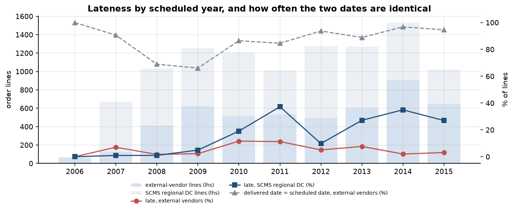
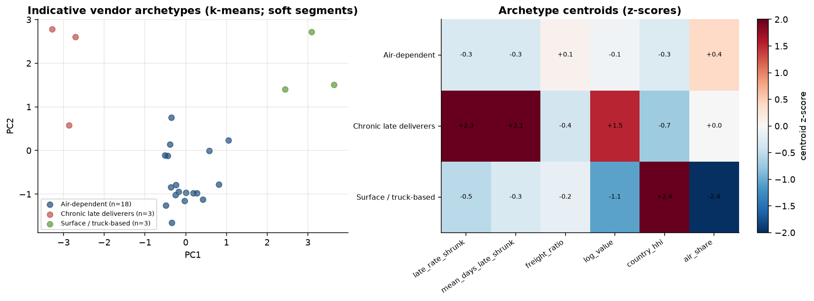

# Health Supply Vendor Risk - Using empirical-Bayes shrinkage and multilevel models to score on-time delivery risk on USAID / PEPFAR health-commodity order lines

> **Outcome:** an empirical-Bayes delivery-risk scorecard for 72 vendors of the USAID / PEPFAR Supply Chain
> Management System (SCMS), built on 10,324 order lines. The scorecard is honest about what it can and cannot
> do: out-of-time line-level AUC is 0.704 for the composite, 0.738 for the shrunk late rate alone
> and 0.730 for the raw late rate on only 21 evaluable vendors and 108 late lines, so a simple
> baseline matches or beats the composite and every interval is wide.

[](https://github.com/Abhi237/supplier-risk-scoring/actions/workflows/ci.yml)
· SQL (DuckDB) · Python (empirical Bayes, scikit-learn) · R (GLM, lme4, MASS, Quarto) · Streamlit

| | |
|---|---|
|  |  |
|  |  |

**Deliverables:** [procurement memo (PDF)](docs/procurement_memo.pdf) · [memo (md)](docs/procurement_memo.md) ·
[R delivery report (HTML)](reports/delivery_report.html) · [EDA notebook](notebooks/01_eda.ipynb) ·
[model notebook](notebooks/02_model_walkthrough.ipynb) · [data dictionary](docs/data_dictionary.md) ·
[data model](docs/data_model.md) · [architecture](docs/architecture.md)

> **Scope and framing.** The buyer is a **US government health-supply programme** (USAID / PEPFAR SCMS). Commodities
> (antiretrovirals, HIV test kits and a few others) are shipped to PEPFAR-supported countries (43 destinations, mostly in
> sub-Saharan Africa). **Nothing here is a US-domestic delivery.** Vendors are the real suppliers named in the dataset.
> On time means `Delivered to Client Date <= Scheduled Delivery Date`. **There is no vendor hand-off timestamp**, so there is no
> vendor-controlled vs end-to-end split: lateness mixes vendor, freight-forwarder and in-country effects. Scores describe
> **recorded delivery performance in this programme, not vendor quality overall**, and rest on limited samples.

## Interactive app
A multipage dark "control tower" Streamlit app (`app/streamlit_app.py`, deployed from `main`) reads **only** derived vendor
scorecards and aggregates committed in `app/data/` (about 0.25 MB; no line-level rows, no raw data).

| Page | What it shows |
|---|---|
| Executive summary | question, KPI cards, risk tiers by value and late value, recommendations |
| Data & quality | provenance, pipeline graph, the cleaning log, DQ checks and definitions |
| Delivery performance | lateness by year, offset distribution, country / mode, R GLM odds ratios and GLMM |
| Vendor scorecards | searchable vendor lookup: raw vs shrunk rates, credible and bootstrap intervals, component radar, cold-start tier |
| Risk model & validation | OOT AUC / lift vs baselines for two targets, AUC-difference intervals, quintiles, back-tests, shrinkage error, cold start |
| Vendor archetypes | k-means archetypes in PCA space, centroid heatmap, silhouette / BIC |
| Exposure & scenario simulator | **ASSUMED** cost sliders, value-at-risk ranking, concentration, back-tested reallocation |
| Methodology & limitations | definitions, scoring maths, validation design, caveats |

```bash
make app-data        # refresh app/data/ from pipeline outputs
make app             # http://localhost:8501
```
Streamlit Community Cloud: main file `app/streamlit_app.py`, Python 3.11, dependencies from `app/requirements.txt`.

| | |
|---|---|
|  |  |
|  |  |

All eight page screenshots (captured headlessly with Playwright): [`docs/app_screenshots/`](docs/app_screenshots/).

---

## 1. Situation and approach
| | |
|---|---|
| **Question** | Which vendors carry the most delivery risk, how sure can we be, and does a score built on the past predict the future? |
| **Data** | 10,324 order lines, 7,030 shipments, 73 vendor strings (72 external vendors plus the programme's own regional distribution centre, "SCMS from RDC", 52% of lines, scored as a reference channel only), scheduled 2006 to 2015 |
| **Method** | DuckDB SQL cleaning with a counted log; beta-binomial empirical-Bayes shrinkage; Bayesian-bootstrap intervals; composite score; k-means archetypes; point-in-time out-of-time validation against baselines; New / unscored cold-start tier; R GLM / GLMM / negative binomial; exposure and ASSUMED reallocation scenarios |
| **Decision** | Monitor the EB-shrunk late rate with its interval; review the 3 High / Elevated vendors with 50+ lines; treat the 43 New / unscored vendors as unknown; do not rely on reallocation until delivery dates are audited |

## 2. Data
| | |
|---|---|
| Source | USAID / PEPFAR SCMS Delivery History (file date 2015-09-29), obtained **without credentials** from the Internet Archive snapshot of the original usaid.gov file (`wayback_usaid_original`); the data.usaid.gov export (SSL error) and the usaid.gov original (HTTP 403) failed. Citation, order tried, SHA-256 values and the licence caveat: [data/README.md](data/README.md) |
| Licence | **unclear**; the raw CSV is git-ignored and fetched by `make data`; only derived vendor scorecards and aggregates are published |
| Integrity | 10,324 rows x 33 columns, unique `ID`, required columns present, delivery dates 0 unparseable |
| Size | line value USD 1,627.6m nominal USD; 43 countries; external vendors 4,920 lines (USD 542.2m) |

**Cleaning log** (`sql/02_cleaning_and_quality.sql`, counts from the data): 6,324 lines have delivered = scheduled
exactly (86.5% for external vendors; possible back-filling); 2,445 freight values are references to another line
(resolved at shipment grain through the first line), 1,442 are "included in commodity cost" and
239 "invoiced separately" (typed, never coerced to 0); 40 lines are capped at
90 days late for mean-lateness metrics only; 209 shipments have freight above
2x value (ratio capped); 17 zero-value lines are kept in counts and excluded from ratios;
3 lines are recorded before delivery; 10 shipments carry two scheduled dates;
360 missing shipment modes are labelled Unknown. Only delivered lines are present, so late rates are lower bounds.

## 3. SQL model (DuckDB)
| Script | Output |
|---|---|
| `01_stage.sql` | typed staging of every raw column used (text kept as typed kinds) |
| `02_cleaning_and_quality.sql` | `cleaning_log` (counted actions) and `dq_report` |
| `03_line_intervals.sql` | `fct_shipments`, `fct_lines`: offset, late, days late, severe, exact-match, known date, shipment freight |
| `04_vendor_summary.sql` | `vendor_lane`, `vendor_summary` |
| `05_vendor_year_panel.sql` | vendor-year panel with rolling 3-year windows, `LAG`, rank, running totals; `programme_year` |
| `06_oot_features.sql` | point-in-time vendor features before `score_end` (outcome known before it) and next-period outcomes |

DuckDB runs single-threaded because parallel floating-point `SUM` is not bit-reproducible.

## 4. Method
* **Shrinkage.** Beta prior fitted by marginal likelihood across vendors: late Beta(0.69, 21.38) (mean 3.1%,
  22 pseudo-lines). Median shift in late rate 2.9 points for vendors under 30 lines vs
  0.2 for 100+; 51 vendors have zero late lines raw and none is scored as exactly zero.
* **Composite** = percentile-weighted components, scored vendors only (>= 10 lines): late_rate_shrunk 0.4, severe_late_rate_shrunk 0.15, mean_days_late_shrunk 0.15, freight_ratio 0.1, lane_mix_risk 0.15, volume_uncertainty 0.05. Weights are a priori, not tuned. Lane mix is context
  (leave-one-vendor-out pooled country / mode late rates), not vendor-controlled.
* **Intervals:** 200 Bayesian-bootstrap draws per vendor (median 90% late-rate interval width 38.5 points under 30 lines vs 14.2 at 100+).
* **Weight sensitivity** (full-period ranking):

| Weights | Spearman vs base | Top-5 overlap |
|---|---|---|
| late_heavy | 0.992 | 100% |
| tail_heavy | 0.985 | 100% |
| no_lane_context | 0.973 | 80% |

## 5. Out-of-time validation
Features at 2012-01-01 use only lines scheduled before it **and** with delivered and recorded dates before it; outcomes are lines scheduled
2012-01-01 to 2016-01-01. The main split was fixed from line volume (about half of vendor lines before it) before any metric was computed. 21 of
24 scored vendors have next-period lines (2,211 lines, 108 late, base rate 4.9%).

| Score | Line AUC (late) | Vendor AUC | Top-20% lift | Line AUC (severe, >14 d) |
|---|---|---|---|---|
| Composite risk score | 0.704 | 0.762 | 1.12x | 0.658 |
| EB-shrunk late rate only | 0.738 | 0.810 | 2.42x | 0.707 |
| Raw late rate (baseline) | 0.730 | 0.786 | 2.42x | 0.686 |
| Volume only (baseline) | 0.373 | 0.190 | 0.00x | 0.450 |
| Lane mix only (baseline) | 0.268 | 0.595 | 0.25x | 0.228 |

* **A simple baseline wins.** Composite minus raw-rate AUC is -0.026 (95% vendor-cluster bootstrap CI -0.060 to +0.055);
  EB rate minus raw rate is +0.007 (CI -0.000 to +0.086). Volume-only and lane-mix-only baselines rank the wrong way (AUC below 0.5).
* Rolling back-tests (line AUC, late target; each split has 16 to 21 evaluable vendors):

| Split | Composite | EB late rate | Raw late rate |
|---|---|---|---|
| 2009-07-01->2011-07-01 | 0.652 | 0.581 | 0.556 |
| 2010-07-01->2012-07-01 | 0.527 | 0.589 | 0.570 |
| 2012-01-01->2016-01-01 | 0.704 | 0.738 | 0.730 |
| 2013-01-01->2016-01-01 | 0.707 | 0.729 | 0.720 |

  The composite beats the raw rate in 1 of 4 splits.
* Shrinkage error by history volume (line-weighted MAE of late-rate estimate against next-period rate):

| Lines in score period | Vendors | Next lines | MAE raw | MAE shrunk |
|---|---|---|---|---|
| 1-4 | 7 | 25 | 0.000 | 0.034 |
| 5-9 | 3 | 12 | 0.094 | 0.080 |
| 10-29 | 7 | 114 | 0.070 | 0.049 |
| 30-99 | 8 | 451 | 0.043 | 0.036 |
| 100+ | 6 | 1646 | 0.050 | 0.049 |

  The 1-4 band has only 25 next-period lines, so a raw rate of 0 can look exact there; the comparison is not informative.

**Cold start (New / unscored).** A vendor below 10 lines at the score date gets the prior mean for every rate, no composite and the tier
New / unscored (`src/supplier_risk/coldstart.py`). In the main split such vendors were 28 vendors, 16.5% of next-period lines
and 2.4% of value. Out-of-time check of the default:

| Split | New vendors | Share of next lines | Prior late | New vendors' next late [95% Jeffreys] | Scored vendors' next late | AUC scored only / full coverage |
|---|---|---|---|---|---|---|
| 2009-07-01->2011-07-01 | 21 | 13.1% | 2.08% | 2.13% [0.60%-5.57%] | 10.62% | 0.581 / 0.525 |
| 2010-07-01->2012-07-01 | 18 | 7.8% | 2.59% | 5.00% [1.71%-11.45%] | 11.60% | 0.589 / 0.598 |
| 2012-01-01->2016-01-01 | 28 | 16.5% | 4.08% | 0.23% [0.02%-1.07%] | 4.88% | 0.738 / 0.762 |
| 2013-01-01->2016-01-01 | 17 | 18.3% | 3.92% | 0.00% [0.00%-0.64%] | 4.78% | 0.729 / 0.756 |

The prior is inside the interval in 2 of 4 splits and too pessimistic in the main split.

## 6. Results
* **Lateness:** 5.3% of external-vendor lines were late (2.5% more than 14 days; median 13 days late when late,
  p90 65); late value 10.4% of value. The regional DC was late 17.2% of the time.
* **R layer:** on 4,920 external-vendor lines (259 late) the vendor random intercept has SD 1.13 (latent ICC **27.8%**, 32.1% without covariates,
  shipment-grain sensitivity 23.6%; median odds ratio 2.9). The all-lines GLM gives the regional DC odds 8.2x
  vendor lines (95% CI 6.6-10.3); truck vs air OR 0.22; negative-binomial theta 0.83
  (Poisson dispersion 26). GLM AUC 0.879 (in-sample). Effects are associations; the Incoterm effect differs in sign between the marginal GLM and the vendor-conditional GLMM, so it is fragile.
* **Risk tiers** (full period, percentile tiers among 29 scored vendors):

| Tier | Vendors | Value share | Late-value share | Late rate |
|---|---|---|---|---|
| High | 3 | 24.4% | 44.7% | 13.9% |
| Elevated | 3 | 28.7% | 47.6% | 12.4% |
| Moderate | 9 | 8.5% | 4.4% | 3.2% |
| Low | 14 | 37.4% | 3.4% | 0.8% |
| New / unscored | 43 | 1.0% | 0.0% | 0.9% |

  The 16 vendors with 50+ lines hold 95% of line value.
* **High / Elevated vendors with 50+ lines:**

| Vendor | Top country | Product | Lines | Late raw | Late EB [90%] | Score [90% boot] | Tier | Archetype |
|---|---|---|---|---|---|---|---|---|
| CIPLA LIMITED | South Africa | ARV | 175 | 13.1% | 12.0% [8.5%-16.0%] | 82.4 [80-86] | High | Chronic late deliverers |
| Aurobindo Pharma Limited | South Africa | ARV | 668 | 14.1% | 13.7% [11.6%-15.9%] | 76.6 [73-78] | High | Chronic late deliverers |
| Orgenics, Ltd | Nigeria | HRDT | 754 | 13.0% | 12.7% [10.8%-14.7%] | 69.7 [67-73] | Elevated | Chronic late deliverers |

* **Indicative archetypes** (k = 3, silhouette 0.49, 24 vendors with 20+ lines):

| Archetype | Vendors | Value share | Median lines | Late (EB) | Mean days late | Freight ratio | Air share | Risk score |
|---|---|---|---|---|---|---|---|---|
| Chronic late deliverers | 3 | 51.4% | 668 | 12.7% | 4.35 | 0.056 | 73% | 77 |
| Air-dependent | 18 | 45.0% | 68 | 1.8% | 0.70 | 0.060 | 100% | 44 |
| Surface / truck-based | 3 | 2.0% | 326 | 1.6% | 0.35 | 0.067 | 0% | 38 |

* **Exposure (observed):** line value USD 542.2m, late value USD 56.5m, value at risk (EB late rate x value) USD 40.4m,
  top 10% of scored vendors hold 95% of it. **ASSUMED** late cost 5% of value and carrying rate
  10% per year give total exposure USD 2.3m (range USD 933k to USD 4.5m over the sensitivity grid).
* **Reallocation back-test (ASSUMED):** moving 50% of the volume of the top 20% of vendors (by composite) to the rest, closing 50%
  of the late-rate gap, avoids 0.0% of next-period late value: the top group's value late rate was 8.8% vs 9.6% for the rest.
  Ranking by the raw late rate would have avoided 21.9%. The best composite grid cell (top 10%, 100% moved, 100% of gap closed) gives 0.14%.


## 7. Actions, trade-offs, limitations
**Actions:** (1) monitor the EB-shrunk late rate with its interval, using the composite for triage and context only; (2) open delivery reviews with the 3 High / Elevated
vendors that have 50+ lines and ask for root causes by lane; (3) treat the 43 New / unscored vendors as unknown and review each at 10 lines;
(4) audit the scheduled-date field before using any reallocation result.

**Trade-offs:** stronger shrinkage protects thin vendors from noise but is slower to flag a genuinely bad newcomer; the volume-uncertainty weight pushes unknown vendors up the list at the cost of some false alarms;
moving volume concentrates spend in fewer vendors.

**Limitations:**
* One programme, one US government buyer, one date definition (delivered vs scheduled); nominal USD 2006-2015.
* No hand-off timestamp: no vendor-controlled vs end-to-end split. 86.5% of vendor lines have delivered = scheduled exactly, so the on-time rate may be overstated.
* Small samples: 43 of 72 vendors have under 10 lines and 259 late lines exist in total; only 21 vendors can be validated out-of-time.
* Predictive validity is modest and a simple baseline wins; the composite weights are a priori and were not tuned.
* Only delivered lines are in the file; vendor names are used as recorded (spelling variants not merged); clusters are soft; costs and the reallocation effect are ASSUMED.
* GLM / GLMM effects are associations; the vendor effect partly reflects product, country and period niche.
* Licence of the source data is unclear; scores are not a statement about any vendor's quality.

## 8. How to run
```bash
make setup          # Python 3.11 venv + pinned deps (requirements.txt) + package
make data           # download + verify the SCMS CSV (no credentials); writes data/raw (git-ignored) and data/interim parquet
make sql            # DuckDB model (sql/01-06), cleaning log
make train          # scoring, bootstrap, clusters, OOT validation, cold start, exposure, scenarios, figures
make report         # R GLM/GLMM/NB + Quarto HTML, memo PDF, README, executed notebooks
make app-data       # export app/data (derived scorecards and aggregates only)
make test           # ruff + pytest
make all            # everything above in order
make app            # Streamlit on :8501
```
Requirements: Python 3.11 (pinned in `requirements.txt` / `requirements-ci.txt`), R >= 4.3 with the packages in [`renv.lock`](renv.lock) (see [`R/README.md`](R/README.md)),
Quarto >= 1.4 (optional), WeasyPrint for the memo PDF. All parameters live in [`config/config.yaml`](config/config.yaml). Two consecutive runs of sql, train, R and export give byte-identical outputs.

**Tests** (`tests/`, no raw data needed): SQL edge cases from a committed handcrafted fixture (date parsing, freight and weight text, see-references, zero / negative values,
internal-channel flag, exact match, caps), grain and key checks, point-in-time leakage tests, shrinkage and bootstrap unit tests, cold start, metric correctness, scenario logic,
determinism, data-download verification, repository hygiene, regression on the committed aggregates, and Streamlit **AppTest** for all eight pages. CI runs ruff + pytest on synthetic fixtures.

## Licence
Code: MIT ([LICENSE](LICENSE)). Data: USAID / PEPFAR SCMS Delivery History, licence unclear; see [data/README.md](data/README.md). Only derived aggregates and vendor scorecards are published.
