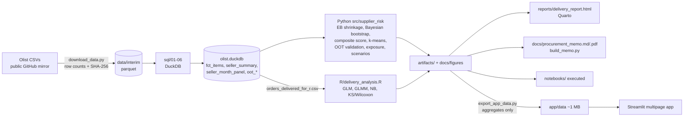

# Architecture

| Step | Command | Main outputs |
|---|---|---|
| data | `make data` | `data/raw/*.csv`, `data/interim/*.parquet`, manifest |
| sql | `make sql` | `data/processed/olist.duckdb`, parquet exports, `artifacts/sql_summary.json` |
| train | `make train` | `artifacts/seller_scores.parquet`, OOT metrics, clusters, scenarios, `docs/figures/*` |
| report | `make report` | `artifacts/r_glm/*`, `reports/delivery_report.html`, memo, executed notebooks |
| app-data | `make app-data` | `app/data/*` |
| test | `make test` | ruff + pytest (fixtures; real-data regression tests run when artifacts exist) |

**Determinism:** all random steps are seeded (`scoring.random_state`, `clustering.random_state`, R `set.seed(42)`);
k-means labels are re-ordered by cluster size. Re-running `make sql train` reproduces identical artifacts.
