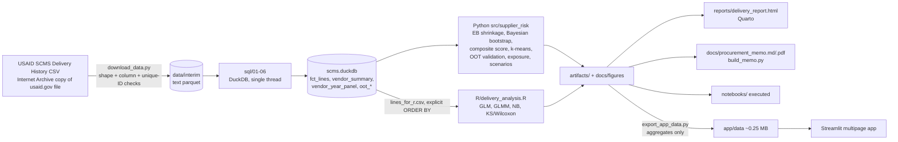

# Architecture

| Step | Command | Main outputs |
|---|---|---|
| data | `make data` | `data/raw/SCMS_Delivery_History_Dataset.csv` (git-ignored), manifest, `data/interim/scms_raw.parquet` |
| sql | `make sql` | `data/processed/scms.duckdb`, parquet exports, `artifacts/sql_summary.json`, `cleaning_log.csv` |
| train | `make train` | vendor scores, OOT metrics, clusters, scenarios, `docs/figures/*` |
| report | `make report` | `artifacts/r_glm/*`, `reports/delivery_report.html`, memo, README, executed notebooks |
| app-data | `make app-data` | `app/data/*` (derived vendor scorecards and aggregates only) |
| test | `make test` | ruff + pytest on committed fixtures (no raw data needed) |

**Determinism.** All random steps are seeded; DuckDB runs single-threaded because parallel floating-point `SUM` is not
bit-reproducible; every export has an explicit `ORDER BY`; k-means labels are re-ordered by cluster size with ties broken by the
lowest vendor index. Two consecutive runs of sql, train, R and export produce byte-identical CSV, JSON, parquet and PNG outputs
(79 files compared by SHA-256).

**Fresh clone.** The raw CSV is not committed. CI and `pytest` use a synthetic SCMS-format generator (`tests/synthetic.py`)
and a handcrafted edge-case table (`tests/fixtures/scms_edge_cases.csv`); regression tests read the committed aggregates in `app/data/`.
