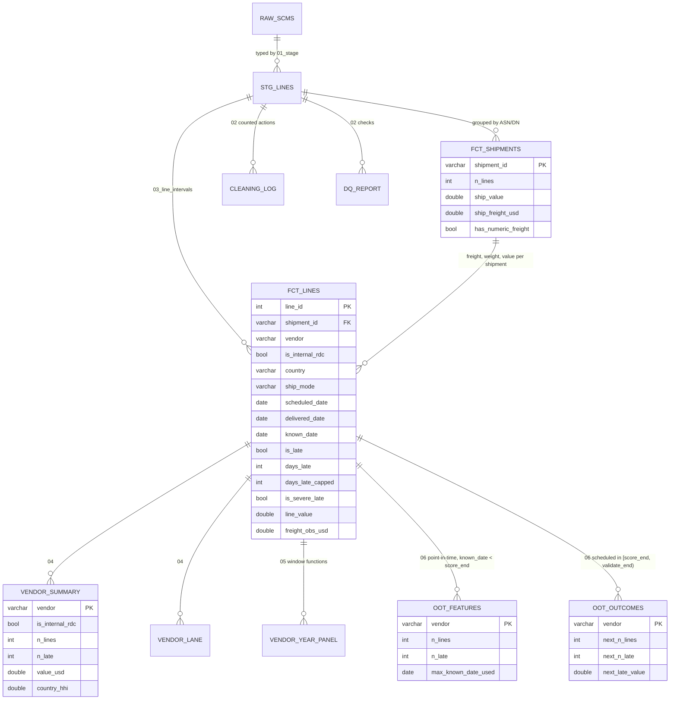

# Data model

One raw table (the USAID / PEPFAR SCMS Delivery History, one row per order line) and the DuckDB model built by `sql/01..06`.

Grain checks (unique keys, row preservation) are enforced in `tests/test_sql_contracts.py`.
The internal regional distribution centre (`SCMS from RDC`) is kept in `fct_lines` and `vendor_summary` with `is_internal_rdc = TRUE`
and excluded from `vendor_lane`, the point-in-time tables and the scored population.
