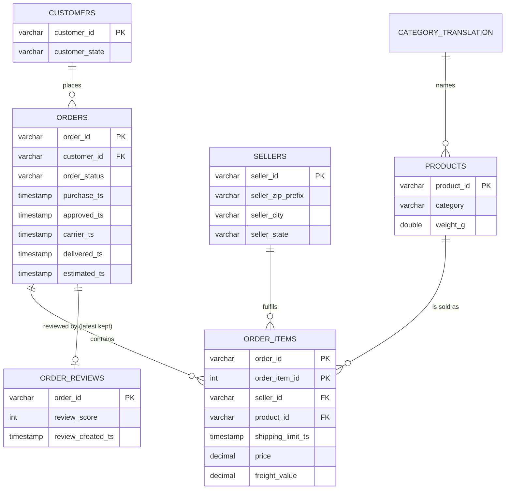
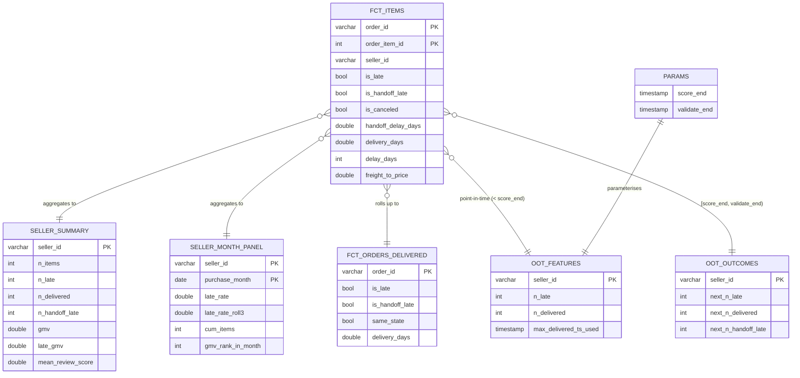

# Data model

Olist source tables (left) and the DuckDB model built by `sql/01..06` (right). **Sellers are proxies for suppliers.**

| Table | Grain | Built in |
|---|---|---|
| `stg_*` | as source (reviews: one per order) | `01_stage.sql` |
| `dq_report` | one row per check | `02_data_quality.sql` |
| `fct_items` | order x item | `03_order_intervals.sql` |
| `fct_orders_delivered` | delivered order | `03_order_intervals.sql` |
| `seller_summary` | seller | `04_seller_summary.sql` |
| `seller_month_panel`, `platform_month` | seller x month, month | `05_seller_month_panel.sql` |
| `oot_features`, `oot_outcomes` | seller (per split) | `06_oot_features.sql` |
