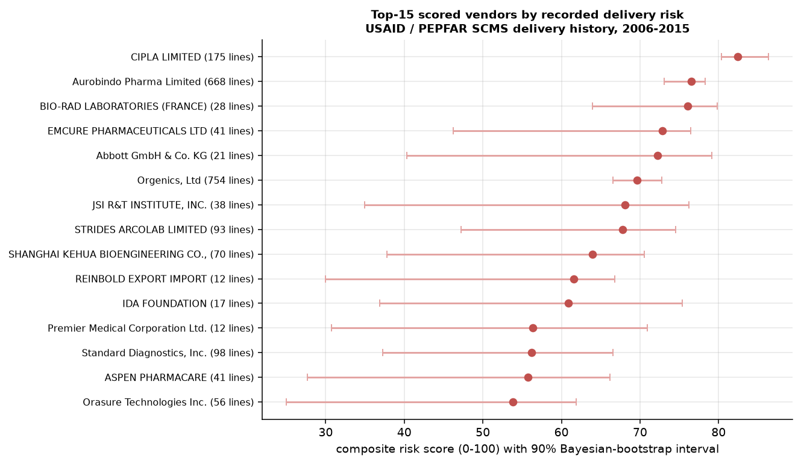

# Procurement memo: delivery-risk scorecard for 72 health-commodity vendors

**To:** supply-chain / vendor-management lead  **Basis:** USAID / PEPFAR SCMS Delivery History (file date 2015-09-29),
10,324 order lines, scheduled 2006 to 2015. Every figure below is read from the pipeline
outputs. **The buyer is a US government health-supply programme and deliveries go to PEPFAR-supported countries; none is a
US-domestic delivery.** On time means delivered-to-client date <= scheduled date. **There is no vendor hand-off timestamp**, so
lateness mixes vendor, freight-forwarder and in-country effects. Scores describe **recorded delivery performance in this programme,
not overall vendor quality**, and rest on limited samples.

## 1. Situation
5.3% of 4,920 external-vendor lines were delivered after the scheduled date (2.5%
more than 14 days late; 10.4% of line value, USD 56.5m of
USD 542.2m). The programme's own regional distribution centre (not a vendor, 52% of lines) was late
17.2% of the time. 86.5% of vendor lines have delivered date equal to scheduled date exactly,
which may reflect back-filled scheduled dates, so the true on-time rate may be lower. Only delivered lines are in the file, so late rates are lower bounds.

## 2. Method
Empirical-Bayes beta-binomial shrinkage of each vendor's late and severe-late rates (prior late rate 3.1%, worth
22 pseudo-lines), a six-component composite (weights fixed a priori, not tuned), Bayesian-bootstrap intervals,
a New / unscored cold-start tier for vendors with fewer than 10 lines (43 of
72 vendors, 2.2% of lines), out-of-time validation (features known before 2012-01-01,
outcomes 2012-01-01 to 2016-01-01), and R GLM / GLMM / negative-binomial models.

## 3. Findings
* **Concentration.** 29 vendors are scored; the 16 with 50+ lines hold
  95% of line value. The High tier (3 vendors) holds 24% of value but
  45% of late value (late rate 13.9%).
* **Shrinkage matters for thin vendors.** Median shift in late rate 2.9 points for vendors
  under 30 lines vs 0.2 for 100+; 51 vendors have zero late lines raw
  but none is scored as exactly zero risk.
* **Out-of-time validity is modest and fragile.** On 21 evaluable vendors (108 late lines of
  2,211), line-level AUC is 0.704 for the composite, 0.738 for the EB late rate alone
  and 0.730 for the raw late rate; volume-only (0.373) and lane-mix-only
  (0.268) rank the wrong way. **A simple baseline wins:** composite minus raw rate is -0.026
  (95% CI -0.060 to +0.055). Across four rolling splits the composite beats the raw late rate in
  1 and loses in 3.
* **Cold start.** New / thin vendors were 16.5% of next-period lines (main split); their late rate was
  0.23% (95% Jeffreys 0.02%-1.07%) against an assigned prior of 4.08%, so the
  prior is too pessimistic there; the assigned prior was inside the interval in 2 of 4 splits.
* **Archetypes are indicative** (24 vendors, silhouette 0.49):
  Chronic late deliverers (3 vendors, 51% of value), Air-dependent (18 vendors, 45% of value), Surface / truck-based (3 vendors, 2% of value).
* **R models.** A vendor random intercept explains a latent 28% of late-delivery variance (32% with no
  covariates; median odds ratio 2.9); lines from the regional DC have odds 8.2x those of vendor lines
  (95% CI 6.6-10.3). These are associations; part of the vendor effect is product and country niche.

| High / Elevated tier vendors with 50+ lines | Top country | Lines | Late (raw) | Late (EB) [90%] | Score [90%] |
|---|---|---|---|---|---|
| CIPLA LIMITED | South Africa | 175 | 13.1% | 12.0% [8.5%-16.0%] | 82 [80-86] |
| Aurobindo Pharma Limited | South Africa | 668 | 14.1% | 13.7% [11.6%-15.9%] | 77 [73-78] |
| Orgenics, Ltd | Nigeria | 754 | 13.0% | 12.7% [10.8%-14.7%] | 70 [67-73] |

 

## 4. Scenario (ASSUMED parameters, not observed)
ASSUMED: moving 50% of the volume of the top 20% of vendors to the rest and closing
50% of the late-rate gap; late cost 5% of line value and carrying rate
10% per year. Value at risk (observed late rate x value, EB-shrunk) is USD 40.4m; ASSUMED-cost exposure
is USD 2.3m, with the top 10% of scored vendors holding 95% of value at risk. Back-tested on
the next period, ranking by the composite would have avoided 0.0% of late value (its top group's value late rate
was 8.8% vs 9.6% for the rest), whereas ranking by the raw late rate would have avoided
21.9%. This also assumes alternative vendors can supply the same product and country, which is often false for sole-source health commodities.

## 5. Recommendations and trade-offs
1. **Use the EB-shrunk late rate with its interval as the primary monitoring KPI**; use the composite for triage and context only, because it did not beat it.
2. **Open delivery-performance reviews with the 3 High / Elevated-tier vendors that have 50+ lines** (table above) and ask for root causes
   by lane: with no hand-off timestamp the data cannot say whether the vendor or the freight leg is responsible.
3. **Treat the 43 New / unscored vendors as unknown, not as good**; review each when it reaches 10 lines.
4. **Do not rely on reallocation until delivery dates are audited** (back-filled dates, undelivered lines absent) and substitutability is confirmed.

*Limitations: one programme and one date definition; 43 of 72 vendors have under
10 lines; 108 late lines drive the main-split metrics; no hand-off split; costs and the reallocation effect are ASSUMED;
GLM effects are associations. Data: USAID / PEPFAR SCMS Delivery History (licence unclear; only derived aggregates are published).*
