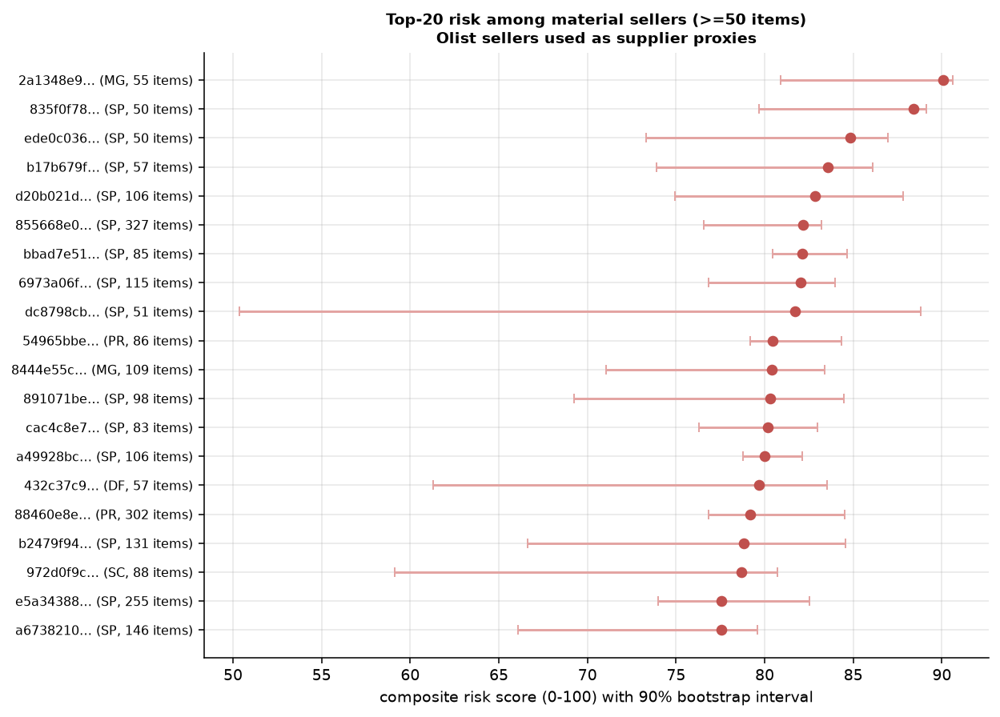

# Procurement Recommendation: Supplier Delivery-Risk & Exposure

**To:** Head of Procurement / Marketplace Ops | **From:** Supplier Analytics | **Data:** Olist Brazilian E-Commerce,
purchases 2016-09-04 to 2018-09-03 (112,650 items, 3,095 sellers). Every figure
is computed by the pipeline in this repository. **Olist sellers are used as proxies for suppliers.** Items marked
**ASSUMED** are scenario inputs, not observed results.

## 1. The question
Which vendors create the greatest delivery-risk and working-capital exposure - and can a score built today tell us
who will cause problems next period?

## 2. What the data says (observed)
* **6.8% of 96,470 delivered orders arrived after the promised date**
  (mean 10.6 days late). Late orders average a 2.27/5 review vs
  4.29 on time.
* **The seller-controlled leg matters most.** 9.4% of items were handed to the carrier after
  the shipping limit; those orders were late 21% of the time vs
  5.4% otherwise. Controlling for lane, region, category, freight and season, a late
  hand-off multiplies the odds of a late delivery by **4.95** (95% CI 4.65-
  5.28; logistic GLM, R).
* **But end-to-end lateness is mostly not a seller trait.** In a seller random-intercept model only
  8.8% of latent variance sits between sellers (5.8% after hand-off is
  controlled). Platform-wide spikes (Nov-2017, Feb-Mar 2018) dominate.
* **Spend is concentrated:** the top 10% of sellers hold 68% of GMV and
  71% of GMV-at-risk.

 

## 3. Does the score predict next period? (out-of-time, scored at 2018-01-01)
1,081 sellers scored on pre-2018 data, evaluated on items bought
2018-01-01 to 2018-09-01 (75% of next-period items).

| Score | AUC: next hand-off late | Top-10% lift | AUC: next late delivery |
|---|---|---|---|
| EB-shrunk hand-off rate | **0.704** | 2.26x | 0.522 |
| Composite risk score | 0.666 | 2.36x | 0.536 |
| Raw hand-off rate (baseline) | 0.681 | 2.56x | 0.519 |
| Raw late rate (baseline) | 0.582 | 2.17x | 0.539 |
| Volume only (baseline) | 0.521 | 1.30x | 0.497 |

* Shrinkage beats the raw rate on hand-off lateness (dAUC +0.023,
  95% CI +0.012 to +0.039)
  and halves the error for sellers with <5 deliveries (MAE 0.124 -> 0.058).
* The riskiest score decile had a next-period hand-off late rate of 21.0% vs
  2.9% in the safest. **No score predicts end-to-end lateness well** (AUC
  <= 0.543); it is carrier/lane/calendar driven.

## 4. Who to act on
* **69 material sellers (>=50 items) are in the High/Elevated tiers**, holding
  7.6% of GMV and 13.7% of late GMV. The
  full High tier (310 sellers) carries 6.5% of GMV but 17.5% of late GMV,
  yet its median seller has only 4 items - treat these as *unknown*, not *bad*.
* **"Slow dispatchers" archetype:** 144 sellers, 10.5% of GMV, median hand-off late rate
  25.8% vs 4.8% for core suppliers - the priority
  group for dispatch-SLA conversations. (Clusters are soft: silhouette 0.17.)

 

## 5. Exposure and the reallocation scenario
* Observed: GMV BRL 13.59m, late GMV BRL 986k, GMV-at-risk BRL 914k, freight
  BRL 2.25m. Working-capital proxy: BRL 407k of GMV in transit on average; delays add
  BRL 30k.
* **ASSUMED** costs (5% of GMV per late item, 30% freight
  absorbed, 10% per cancellation) give total exposure of
  BRL 729k - a scenario figure, not a P&L.
* **Back-tested reallocation (ASSUMED):** moving 50% of the top-10% sellers'
  next-period volume, closing 50% of the gap, would have avoided only
  0.29% of late GMV (BRL 1,282); even the most aggressive grid cell
  (top 20%, all volume, full gap) gives 1.7%. On the seller-controlled leg the same
  move cuts late hand-offs by 4.1%.

## 6. Recommendations & trade-offs
1. **Adopt the EB-shrunk hand-off late rate as the supplier SLA KPI**, reviewed monthly with intervals; it is the
   most predictive, least noisy signal and is what sellers control.
2. **Run dispatch-SLA reviews with the 69 material High/Elevated sellers**, starting with "Slow dispatchers";
   use the composite only for triage (it adds review/cancellation/freight context but predicts no better).
3. **Do not expect volume reallocation to fix customer lateness**; carrier and lane performance (North/Northeast
   lanes, peak months) need a logistics workstream.
4. **Onboarding watch-list, not penalties, for low-volume sellers** (1,201 have <5 items).

*Limitations: sellers are marketplace merchants, not contracted suppliers; costs are ASSUMED; scores cover
75% of next-period items (new sellers unscored); multi-seller orders share timestamps;
GLM effects are associations. Data: Olist, CC BY-NC-SA 4.0.*
