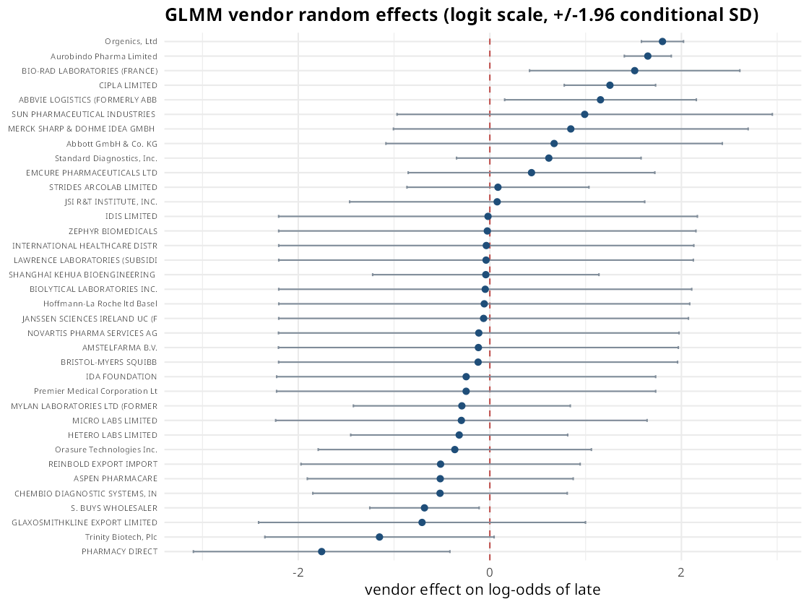
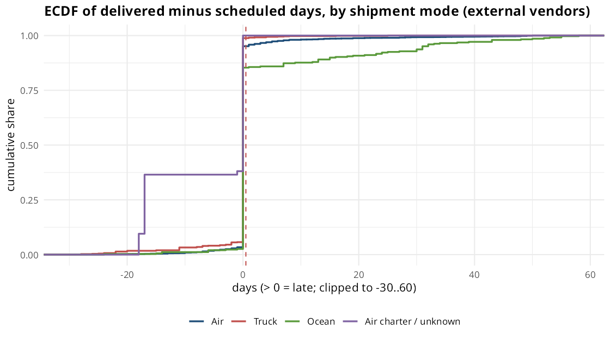
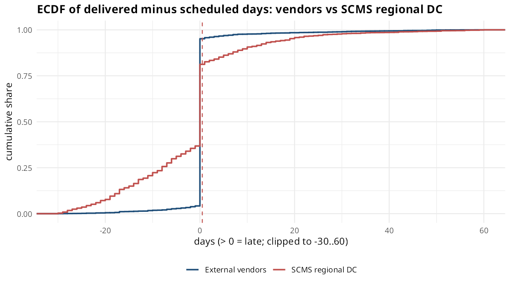

## Question and design

The Python layer ranks vendors by recorded delivery risk. This report asks the explanatory question:
**after controlling for destination country, shipment mode, product group, contract terms, order size, freight and
period, how much of whether a line is delivered late is attributable to the vendor?**

* **Data:** USAID / PEPFAR Supply Chain Management System (SCMS) delivery history, U.S. Agency for International
  Development (data.usaid.gov; Kaggle copy "Supply Chain Shipment Pricing Data"). The buyer is a US government program;
  deliveries go to PEPFAR-supported countries, mostly in sub-Saharan Africa. These are **not** US-domestic deliveries.
* **Unit:** one order line (`fct_lines`, built in `sql/03_line_intervals.sql`). Population: the external-vendor lines.
  Lines served from SCMS's own regional distribution centre (vendor string "SCMS from RDC") are not a vendor and are
  compared separately.
* **Outcome:** `late` = delivered-to-client date **after** the scheduled delivery date. **The dataset has no separate
  vendor hand-off timestamp**, so a late line can reflect the vendor, the freight forwarder or in-country handling; the
  vendor-controlled vs end-to-end split is not observable here.
* **Scores describe recorded delivery performance for this programme, not vendor quality overall.**

The models are fitted by `R/delivery_analysis.R` (run by `make report` before this document renders); this report reads
its outputs from `artifacts/r_glm/`.

```{r setup}
library(readr); library(dplyr); library(knitr); library(jsonlite)
root <- normalizePath("..")
out <- file.path(root, "artifacts", "r_glm")
rd <- function(f) read_csv(file.path(out, f), show_col_types = FALSE)
s <- fromJSON(file.path(out, "r_summary.json"))
pct <- function(x, d = 1) paste0(formatC(100 * x, format = "f", digits = d), "%")
```

`r format(s$n_lines, big.mark = ",")` external-vendor lines from `r s$n_vendors` vendors, of which `r s$n_late`
(`r pct(s$late_rate)`) were delivered after the scheduled date.

## 0. A data caveat that shapes everything

In the external-vendor lines the delivered date equals the scheduled date exactly for most lines (see the Python
cleaning log for the count). Lateness is therefore observable only in the minority of lines where the two dates
differ, and the on-time rate is likely **overstated** if scheduled dates were back-filled with actual dates in some
records. Also, only delivered lines are in the file: undelivered or cancelled lines are absent.


## 1. Logistic GLM for lateness

$$\text{logit}\,P(\text{late}) = \beta_0 + \text{mode} + \text{product group} + \text{country} + \text{INCO term} +
\text{period} + \text{std. log value} + \text{log freight ratio} + \text{freight-missing flag} + \log(\text{lines in shipment})$$

```{r or}
or <- rd("glm_odds_ratios.csv")
kable(or %>% dplyr::select(term, odds_ratio = estimate, conf.low, conf.high, p.value), digits = 3,
      caption = "Odds ratios (95% Wald CI). Reference: Air, ARV, South Africa, EXW, 2010-12")
```


**Reading:** Truck shipments have lower odds of lateness than air (OR `r round(s$or_truck, 2)`), HRDT / other products
higher than ARVs (OR `r round(s$or_hrdt, 2)`), and shipments with more lines have lower odds (OR `r round(or$estimate[or$term == "log_ship_lines"], 2)` per unit of log lines) - mostly because the many late lines sit in single-line shipments. With only
`r s$n_late` late lines and many country levels, the country intervals are wide: treat these as associations,
not effects. Period matters (likelihood-ratio deviance `r round(s$lrt_year_dev, 1)`, p =
`r format.pval(s$lrt_year_p, digits = 2)`): lateness is not stable over time (see the year terms and the yearly figure above).

In-sample AUC is `r round(s$glm_auc, 3)` (not an out-of-time number; the out-of-time validation is in the Python layer).

### Diagnostics

```{r calib}
kable(rd("glm_calibration_deciles.csv"), digits = 4, caption = "Calibration by predicted-risk decile")
```


* Hosmer-Lemeshow (10 bins): statistic `r round(s$hosmer_lemeshow_stat, 1)`, p = `r format.pval(s$hosmer_lemeshow_p, digits = 2)`.
* Collinearity: maximum GVIF^(1/(2 df)) = `r round(s$max_gvif_adj, 2)`.

```{r vif}
kable(rd("glm_vif.csv"), digits = 2, caption = "Generalised VIFs")
```

### SCMS regional distribution centre vs external vendors

On all lines, controlling for mode, product group, period and order value, lines served from the regional distribution
centre have odds ratio **`r round(s$or_internal_rdc_vs_vendor, 2)`** (95% CI `r round(s$or_internal_rdc_lo, 2)`-`r round(s$or_internal_rdc_hi, 2)`)
of being late versus external-vendor lines. That channel is the program's own logistics, not a vendor, which is why it is
excluded from vendor scoring.

## 2. How much varies by vendor? Random-intercept GLMM

Vendor random intercept with the same fixed effects (no country terms, to keep the model identifiable with few vendors),
fitted on `r format(s$glmm_n_lines, big.mark=",")` lines from the `r s$glmm_n_vendors` vendors with at least 5 lines.

| | vendor SD (logit) | latent ICC |
|---|---|---|
| intercept only | `r round(s$glmm_vendor_sd_null, 3)` | `r pct(s$glmm_icc_null)` |
| with fixed effects | `r round(s$glmm_vendor_sd, 3)` | `r pct(s$glmm_icc)` |
| shipment-grain sensitivity (one row per shipment) | `r round(s$glmm_ship_vendor_sd, 3)` | `r pct(s$glmm_ship_icc)` |

The vendor random effect is clearly non-zero (likelihood-ratio statistic `r round(s$glmm_lr_vendor, 1)`, boundary-corrected
p = `r format.pval(s$glmm_p_vendor_boundary, digits = 2)`), with median odds ratio `r round(s$glmm_mor, 2)` between a typical
vendor and a vendor one random draw away. Unlike a marketplace with thousands of sellers, here a **stable vendor-level
component is detectable** - but with 36 vendors this is a variance estimate with wide uncertainty, and part of the
"vendor" effect is the vendor's product/country/season niche that the covariates only partly absorb.

```{r glmm}
or_re <- rd("glmm_odds_ratios.csv")
kable(or_re, digits = 3, caption = "GLMM fixed effects, odds ratios (95% Wald CI)")
```



## 3. Count model: days late among late lines (negative binomial)

Days late is only defined for late lines (second stage of a hurdle model). We model `days_late - 1 >= 0` with a negative
binomial (`r s$nb_n_late_lines` late lines). Pearson dispersion under Poisson is `r round(s$poisson_dispersion, 1)` (theta =
`r round(s$nb_theta, 2)`), so Poisson is clearly inadequate. This ignores zero-truncation beyond the shift and is an
approximation.

```{r nb}
irr <- rd("nb_rate_ratios.csv")
kable(irr %>% dplyr::select(term, rate_ratio = estimate, conf.low, conf.high, p.value), digits = 3,
      caption = "Days-late rate ratios (95% CI)")
```

## 4. Delivered-minus-scheduled distributions (KS / Wilcoxon, ECDFs)

```{r tests}
kable(rd("offset_tests.csv"), digits = 4,
      caption = "Two-sample Kolmogorov-Smirnov and Wilcoxon rank-sum tests on signed days (delivered - scheduled)")
```

Medians are 0 in every group because most lines are delivered exactly on the scheduled date, so the tests mainly
compare the tails. Kruskal-Wallis across countries: H = `r round(s$kruskal_country_H, 1)`, p < 0.001.





## Caveats

* One programme, 2006-2015 scheduled dates, nominal USD; results do not transfer to other buyers.
* Observational data: odds ratios are associations conditional on the covariates, not causal effects.
* The delivered/scheduled date definition, the share of exact matches and the absence of undelivered lines
  limit what "late" means.
* Lines in a shipment share dates; the shipment-grain GLMM is reported as a sensitivity check.
* With 259 late lines among 72 vendors, intervals are wide and several coefficients are poorly determined.

## Reproducibility

`r s$r_version`. Package versions:
`r paste(names(s$pkg_versions), unlist(s$pkg_versions), collapse = ", ")`. Full `sessionInfo()` is in
`artifacts/r_glm/sessionInfo.txt`. See `R/README.md`.
