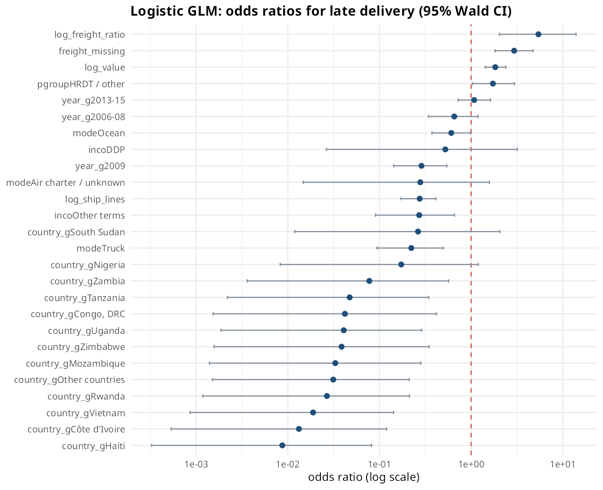
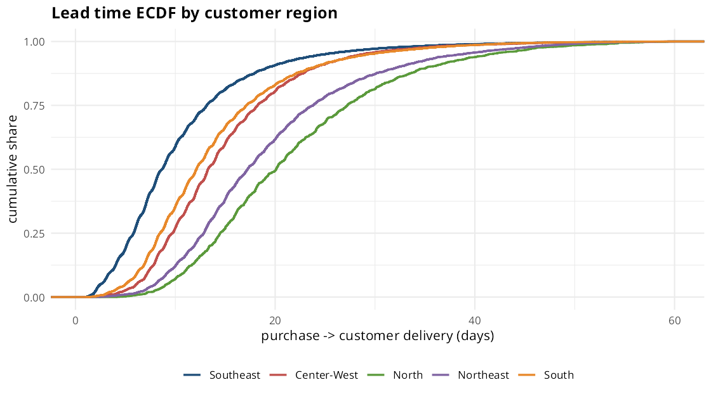
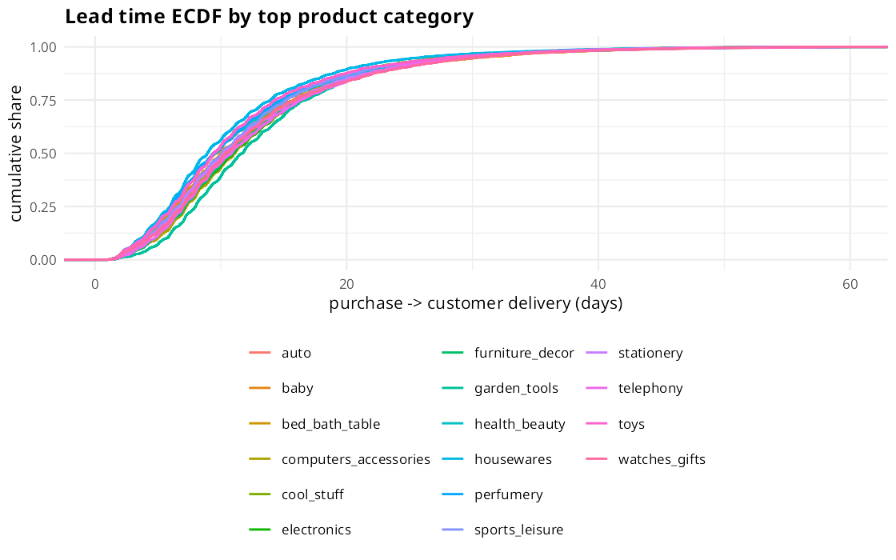

## Question and design

The Python layer ranks sellers by reliability. This report asks a complementary, explanatory question:
**after controlling for geography, lane, product category, freight and seasonality, how much of a late
delivery is attributable to the seller?**

* **Unit:** one delivered order (`fct_orders_delivered`, built in `sql/03_order_intervals.sql`).
* **Outcome:** `late` = customer delivery date after the estimated delivery date shown at purchase.
* **Seller-controlled leg:** `handoff_late` = carrier hand-off after the item's `shipping_limit_date`.
* **Olist sellers are proxies for suppliers.** They are marketplace merchants, not a buyer's contracted
  vendors; findings transfer as *method*, not as vendor facts.

The models are fitted by `R/delivery_analysis.R` (run by `make report` before this document renders);
this report reads its outputs from `artifacts/r_glm/`.

```{r setup}
library(readr); library(dplyr); library(knitr); library(jsonlite)
root <- normalizePath("..")
out <- file.path(root, "artifacts", "r_glm")
rd <- function(f) read_csv(file.path(out, f), show_col_types = FALSE)
s <- fromJSON(file.path(out, "r_summary.json"))
pct <- function(x, d = 1) paste0(formatC(100 * x, format = "f", digits = d), "%")
```

`r format(s$n_orders, big.mark = ",")` delivered orders, of which `r pct(s$late_rate)` arrived after the
estimate.

## 1. Logistic GLM for lateness

$$\text{logit}\,P(\text{late}) = \beta_0 + \beta_1\,\text{handoff\_late} + \text{customer region} +
\text{seller region} + \text{same state} + \log(1+\text{freight/price}) + \log\text{GMV} +
\text{category} + \text{month} + \text{year}$$

```{r or}
or <- rd("glm_odds_ratios.csv") %>% filter(!grepl("^month|^year", term))
kable(or %>% dplyr::select(term, odds_ratio = estimate, conf.low, conf.high, p.value), digits = 3,
      caption = "Odds ratios (95% Wald CI); month and year fixed effects omitted from the table")
```



**Reading:** a late seller hand-off multiplies the odds of a late customer delivery by
**`r round(s$or_handoff, 2)`** (95% CI `r round(s$or_handoff_lo, 2)`-`r round(s$or_handoff_hi, 2)`),
holding lane, category, freight and season fixed. Same-state lanes have odds ratio
`r round(s$or_same_state, 2)`. Remote customer regions (North, Northeast) carry the largest geographic
penalties.

Adding `handoff_late` raises in-sample AUC from `r round(s$glm_auc_without_handoff, 3)` to
`r round(s$glm_auc, 3)` (likelihood-ratio deviance `r round(s$lrt_handoff_dev, 0)`, p < 0.001).

### Diagnostics

```{r calib}
kable(rd("glm_calibration_deciles.csv"), digits = 4, caption = "Calibration by predicted-risk decile")
```



```{r calstats}
cd <- rd("glm_calibration_deciles.csv")
max_dev <- max(abs(cd$observed - cd$mean_pred))
```

* Hosmer-Lemeshow (10 bins): statistic `r round(s$hosmer_lemeshow_stat, 1)`, p =
  `r format.pval(s$hosmer_lemeshow_p, digits = 2)`. With ~96k orders this test rejects even small
  miscalibration: the largest absolute gap between predicted and observed late rate in any decile is
  `r round(100 * max_dev, 1)` percentage points. The model is used for *explanation*, not as the production score.
* Collinearity: maximum GVIF^(1/(2·df)) = `r round(s$max_gvif_adj, 2)` (all well below the usual 2-3 concern level).

```{r vif}
kable(rd("glm_vif.csv"), digits = 2, caption = "Generalised VIFs")
```

## 2. How much varies by seller? Random-intercept GLMM

Same fixed effects plus a seller random intercept, fitted on `r format(s$glmm_n_orders, big.mark=",")`
orders from the `r format(s$glmm_n_sellers, big.mark=",")` sellers with at least 5 delivered orders.

| | seller SD (logit) | latent ICC |
|---|---|---|
| without hand-off term | `r round(s$glmm_seller_sd_without_handoff, 3)` | `r pct(s$glmm_icc_without_handoff)` |
| with hand-off term | `r round(s$glmm_seller_sd, 3)` | `r pct(s$glmm_icc)` |

Only `r pct(s$glmm_icc_without_handoff)` of the latent variance in lateness sits between sellers, and
about a third of that is explained by their hand-off behaviour. **Most end-to-end lateness is lane,
carrier and calendar noise, not a stable seller trait** - which is exactly why the Python out-of-time
validation finds seller-level scores predict next-period *hand-off* lateness far better than next-period
*end-to-end* lateness.

## 3. Lead time: negative binomial model

Delivery lead time (days, rounded) is over-dispersed relative to Poisson (Pearson dispersion
`r round(s$poisson_dispersion, 2)`), so a negative binomial GLM is used (theta =
`r round(s$nb_theta, 2)`).

```{r nb}
irr <- rd("nb_rate_ratios.csv") %>% filter(!grepl("^month|^year", term))
kable(irr %>% dplyr::select(term, rate_ratio = estimate, conf.low, conf.high, p.value), digits = 3,
      caption = "Lead-time rate ratios (95% CI)")
```

A late hand-off lengthens expected lead time by `r pct(s$irr_handoff - 1, 0)`; a same-state lane shortens it
by `r pct(1 - s$irr_same_state, 0)`.

## 4. Lead-time distributions (KS / Wilcoxon, ECDFs)

```{r tests}
kable(rd("leadtime_tests.csv"), digits = 4,
      caption = "Two-sample Kolmogorov-Smirnov and Wilcoxon rank-sum tests on delivery days")
```

Kruskal-Wallis across top categories: H = `r round(s$kruskal_category_H, 1)`, p < 0.001.





## Caveats

* Observational data: odds ratios are associations conditional on the covariates, not causal effects.
  Hand-off lateness may proxy for unobserved seller capacity problems.
* Multi-seller orders (~1%) share one carrier/delivery timestamp; they are kept with the first seller.
* Estimated delivery dates are set by Olist and may embed regional slack, which dampens regional effects
  on *lateness* relative to *lead time*.

## Reproducibility

`r s$r_version`. Package versions:
`r paste(names(s$pkg_versions), unlist(s$pkg_versions), collapse = ", ")`. See `R/README.md`.
